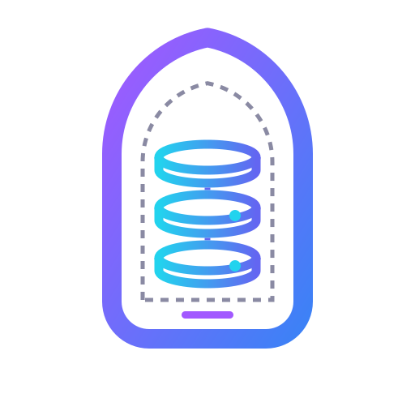

<p align="center"></p>

<p align="center">
  <a href="https://github.com/aristonis/diwan-database/actions/workflows/ci.yml"></a>
  <a href="https://central.sonatype.com/artifact/org.aristonis/diwan-database"></a>
  <a href="https://github.com/aristonis/diwan-database/releases/latest"></a>
  <a href="https://github.com/aristonis/diwan-database/releases"></a>
  <a href="https://github.com/aristonis/diwan-database/stargazers"></a>
  <a href="https://javadoc.io/doc/org.aristonis/diwan-database"></a>
  <a href="https://github.com/aristonis/diwan-database/commits"></a>
  <a href="https://github.com/aristonis/diwan-database/issues"></a>
  <a href="https://github.com/aristonis/diwan-database/graphs/contributors"></a>
  <a href="LICENSE"></a>
  
  
  <a href="https://aristonis.org/open-source/diwan-database/docs/main/home"></a>
</p>

# Diwan Database

Diwan Database is a hand port of Laravel's database layer (`illuminate/database`) to Java. It
keeps Laravel's layers and method names where they read well in Java, and uses Java's own idioms
(`Optional`, `java.time`, try-with-resources, unchecked exceptions) where PHP shaped Laravel's
choices.

It covers a connection with nested transactions and savepoints, a schema builder, a query builder,
migrations, and Eloquent-style models with relations. It has no runtime dependency.

## Modules

| Module | Adds |
|---|---|
| `diwan-database` | Connection, JDBC adapter, schema and query builders, migrator. |
| `diwan-database-sqlite` | The SQLite grammars. |
| `diwan-database-pgsql` | The PostgreSQL grammars and the migration lock. |
| `diwan-database-eloquent` | Models, relations, eager loading, scopes and soft deletes. |
| `diwan-database-android` | A driver over Android's own `SQLiteDatabase`. |

All of them are published as `org.aristonis:<module>:0.1.0`.

```kotlin
implementation("org.aristonis:diwan-database:0.1.0")
implementation("org.aristonis:diwan-database-sqlite:0.1.0")   // or -pgsql, plus the PostgreSQL JDBC driver
implementation("org.aristonis:diwan-database-eloquent:0.1.0") // optional
```

```xml
<dependency>
  <groupId>org.aristonis</groupId>
  <artifactId>diwan-database</artifactId>
  <version>0.1.0</version>
</dependency>
```

Not yet published. Build it locally with `./gradlew check`.

## Platforms

- Java 17 or later. The JAR is plain Java 17 bytecode, tested on JDK 17, 21 and 25.
- Android 9 (API 28) or later, through `diwan-database-android`. The build checks the core against
  the Android 28 API.
- Spring, through a `JdbcConnectionProvider` that reports Spring's transaction, so Diwan nests
  inside it with savepoints instead of committing it.
- Databases: SQLite, PostgreSQL and Android's SQLite.

## Quick start

```java
// Configuration names the driver, so this code never imports a SQLite or PostgreSQL class.
DatabaseManager manager = DatabaseManager.builder()
        .config(DatabaseConfig.from(MapConfigSource.of(Map.of(
                "database.default", "main",
                "database.connections.main.driver", "sqlite",
                "database.connections.main.database", "app.db"))))
        .connector(new SQLiteConnector())
        .build();

// Migration: run what is pending, one transaction per migration.
manager.migrator("main").add(new CreateUsersTable()).build().run();

// Query builder, with Laravel's method names.
QueryFactory db = manager.query();
db.table("users").insert(Map.of("email", "ada@example.com"));
List<Map<String, Object>> rows = db.table("users")
        .where("email", "like", "%@example.com")
        .orderByDesc("id")
        .get();

// Model: one class per table, no reflection or annotations.
public final class User extends Model {
    public static final ModelQuery<User> query = ModelQuery.of(User.class, User::new);

    @Override
    protected List<String> fillable() {
        return List.of("name", "email");
    }
}
User ada = User.query.on(db).create(Map.of("name", "Ada", "email", "ada@example.com"));
```

Switching to PostgreSQL changes the `driver` and adds a host in the configuration, and registers
`PostgresConnector`. Nothing else changes. Without a manager, build a `Connection` and take the
factories from the grammar module: `SQLiteQuery.of(connection)`, `SQLiteSchema.of(connection)`,
`PostgresQuery.of(connection)`, `PostgresSchema.of(connection)`.

Inside a transaction, pass the connection you were handed (`tx`) to everything the work calls. The
outer connection refuses calls from inside its own transaction, because they would run outside it.
Always open a cursor in try-with-resources: one that is neither read to the end nor closed keeps
its connection.

## Documentation

The guides live at <https://aristonis.org/open-source/diwan-database/docs/main/home>.

| Guide | Covers |
|---|---|
| [Connections](https://aristonis.org/open-source/diwan-database/docs/main/connections-and-transactions) | Running SQL, transactions, pretend mode, the manager. |
| [Query builder](https://aristonis.org/open-source/diwan-database/docs/main/query-builder) | Reads, writes, joins, pagination, cursors. |
| [Schema](https://aristonis.org/open-source/diwan-database/docs/main/schema-builder) | Tables, columns, indexes, checks, `change()`. |
| [Migrations](https://aristonis.org/open-source/diwan-database/docs/main/migrations) | The migrator, rollback, status, locks. |
| [Models](https://aristonis.org/open-source/diwan-database/docs/main/models) | Casts, accessors, events, scopes. |
| [Relations](https://aristonis.org/open-source/diwan-database/docs/main/relations) | Has-many, many-to-many, morph, eager loading. |
| [Android](https://aristonis.org/open-source/diwan-database/docs/main/android) | The driver, R8, thread rules. |
| [Differences from Laravel](https://aristonis.org/open-source/diwan-database/docs/main/differences-from-laravel) | Where Diwan chooses differently. |
| [Errors](https://aristonis.org/open-source/diwan-database/docs/main/errors-and-exceptions) | Exception types and how to handle them. |

In this repository, `docs/` holds the living behavior pages, the requirements, the design and the
decision records:

- [System design](docs/architecture/system-design.md) and [connection design](docs/architecture/connection-design.md)
- Behavior: [connection](docs/behavior/connection/README.md), [schema](docs/behavior/schema/README.md),
  [query](docs/behavior/query/README.md), [migrations](docs/behavior/migrations/README.md),
  [migrator](docs/behavior/migrator/README.md), [models](docs/behavior/eloquent/README.md)
- [Decision records](docs/adr/)
- [Documentation standard](docs/documentation-standard.md)

## For coding agents

The [`ai/`](ai/README.md) folder has an `AGENTS.md` rules file and one skill per task (usage, query
builder, migrations, models and relations, Android, reporting an issue). Copy them into your
project so an agent writes correct Diwan code. The same material is at
<https://aristonis.org/open-source/diwan-database/docs/main/overview>.

## Security

Report a vulnerability privately through [GitHub private vulnerability reporting](https://github.com/aristonis/diwan-database/security/advisories/new), never as a public issue. See [SECURITY.md](SECURITY.md).

## Project

- [Changelog](CHANGELOG.md) and [releases](https://github.com/aristonis/diwan-database/releases)
- [Roadmap](ROADMAP.md): what is planned next
- License: MIT, see [LICENSE](LICENSE).
- Contributing: see [CONTRIBUTING.md](CONTRIBUTING.md) and the [code of conduct](CODE_OF_CONDUCT.md). Build and test with `./gradlew check`; Javadoc and docs follow the
  [documentation standard](docs/documentation-standard.md).

## Notes

AI AGENT (claude) help to build this and write code
