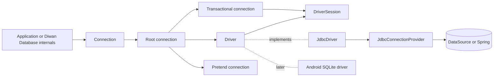
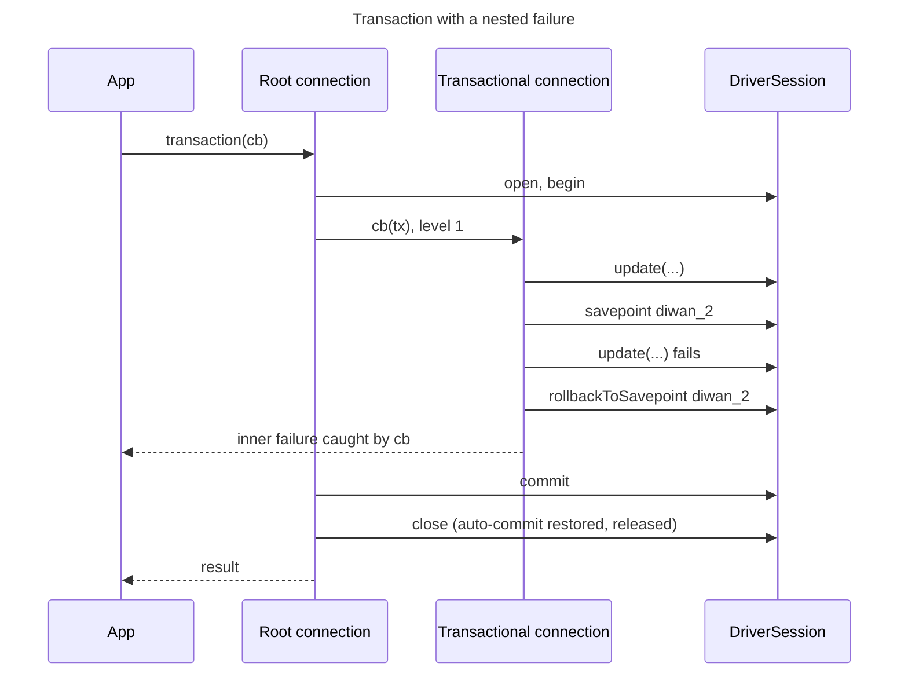

# Connection design

How the `Connection` runs SQL, manages transactions and records SQL in pretend mode over any
database driver, on Java 17 desktop and server runtimes, Android 9 and later, and inside Spring
applications.

## Index

1. Purpose and scope
2. Architecture
3. Packages
4. Public API
5. Driver interface
6. JDBC adapter
7. Transactions
8. Pretend
9. Errors
10. Bindings and rows
11. Threads
12. Build rules
13. Diagrams
14. Rejected alternatives

## 1. Purpose and scope

Every part of Diwan Database that talks to a database (schema builder, migration repository, migrator,
query builder) sends SQL through one `Connection`. The design follows Laravel's
`Illuminate\Database\Connection` in names and behaviour where they read well in Java, and uses
Java's own strengths (`Optional`, `java.time`, functional interfaces, try-with-resources,
unchecked exceptions) where PHP shaped Laravel's choices.

The Javadoc of each type named here is the binding contract. This document explains the structure
and the rules behind it.

Out of scope here: SQL grammars, schema builder, query builder, per-database driver modules, the
Android and Spring adapters (the interfaces below make them possible), read and write connection
split, reconnecting, query events.

## 2. Architecture

Ports and adapters. The core (`Connection` and its implementations) depends only on the driver
interface. The JDBC adapter implements that interface over `java.sql`. An Android adapter over
`android.database.sqlite` and a Spring connection provider plug in later without changing the core.

R1. The core imports no `java.sql` or `javax.sql` type, with two exceptions on
`ConnectionBuilder`: `dataSource(DataSource)` and `connectionProvider(JdbcConnectionProvider)`, the
two JDBC entry points. `javax.sql.DataSource` exists on Android, so the exception does not stop
the core from loading there. The driver package uses no JDBC type in any signature. Only the JDBC
adapter package works with JDBC.

R2. The core holds no `ThreadLocal` and no static mutable state. Explicit per-connection state that
is safe across threads is allowed (strict mode, section 11).

R3. A physical database connection is held only for the length of one call, or for the length of
one transaction or transaction scope, never longer.

R4. Diwan Database ends only the transactions it started. It never commits, fully rolls back, closes or
changes auto-commit on a connection that is inside a transaction owned by someone else.

R5. A driver session restores the connection state it changed (auto-commit) before it gives the
connection back, on every path.

R10. Every later layer (schema builder, migrator, query builder, models) takes the `Connection` it
works on per call or per unit of work, never captures the root for later use. Inside a
transaction, the connection handed to the callback is the one to pass on.

## 3. Packages

| Package | Holds | Public |
|---|---|---|
| `org.aristonis.diwan.database` | `Connection`, `ConnectionBuilder`, `TransactionScope`, `TransactionCallback`, `PretendCallback`, `LoggedQuery`, `QueryException`, `UniqueConstraintViolationException`, `MultipleColumnsSelectedException`; package-private implementations | API types only |
| `org.aristonis.diwan.database.driver` | `Driver`, `DriverSession`, `DriverInfo`, `DriverCapability`, `DriverException`, `DriverFailureKind` | yes, for adapter authors |
| `org.aristonis.diwan.database.jdbc` | `JdbcDriver`, `JdbcConnectionProvider`, `DataSourceConnectionProvider`; package-private session, value and failure helpers | yes |

The `Connection` implementations (root, transactional, transaction scope, pretend) stay
package-private, so callers depend on the interface only.

## 4. Public API

`Connection` (interface):

| Method | Returns | Laravel name kept |
|---|---|---|
| `statement(sql, bindings)` | `boolean`, true once it ran | yes |
| `affectingStatement(sql, bindings)` | `int` rows | yes |
| `insert`, `update`, `delete` | `boolean`, `int`, `int` | yes |
| `select(sql, bindings)` | `List<Map<String, Object>>`, unmodifiable, ordered | yes |
| `selectOne(sql, bindings)` | `Optional<Map<String, Object>>` | name kept, Java return |
| `scalar(sql, bindings)` | `Optional<Object>`; empty for no row or SQL NULL | name kept, Java return |
| `unprepared(sql)` | `boolean` | yes |
| `transaction(TransactionCallback<T>)` | `T` | yes |
| `transaction(TransactionCallback<T>, int attempts)` | `T` | yes |
| `beginTransaction()` | `TransactionScope` (`AutoCloseable`) | name kept, Java scope |
| `pretend(PretendCallback)` | `List<LoggedQuery>`, unmodifiable | yes |
| `transactionLevel()` | `int` | yes |
| `getName()`, `getTablePrefix()` | `String` | yes |

Every SQL method takes its bindings either as varargs or as a `List<?>`. A null varargs array or a
null list is refused. A `String[]` or `Integer[]` passed alone spreads into separate bindings (Java
array covariance); the Javadoc warns about it.

`Connection` is not meant to be implemented outside this library; the Javadoc says so, and methods
added later arrive as `default` methods so existing code keeps compiling.

`Connection.builder()` returns a `ConnectionBuilder`:

| Setting | Default |
|---|---|
| `name(String)` | required; blank refused |
| `dataSource(DataSource)`, `connectionProvider(JdbcConnectionProvider)` or `driver(Driver)` | required, exactly one; a second is refused |
| `tablePrefix(String)` | empty; only ASCII letters, digits and underscores, because grammars paste it into identifiers |
| `showBindingsInErrors(boolean)` | false |
| `strictTransactions(boolean)` | true (section 11) |
| `onCleanupFailure(Consumer<Throwable>)` | a warning through `java.util.logging` |

`build()` takes a snapshot of the settings; changing the builder afterwards does not affect the
connection.

`TransactionCallback<T>`: `T run(Connection connection)`. One callback type for every transaction
call, because a `Consumer` overload beside a `Function` one makes `tx -> tx.insert(...)`
ambiguous to the compiler. A callback with no result returns `null`. Callbacks throw unchecked
exceptions only.

`PretendCallback`: `void run(Connection connection)`.

`TransactionScope extends Connection, AutoCloseable`: `commit()`; `close()` rolls back when
`commit()` was not called or failed, and throws no checked exception. Closing twice does nothing.
Any call after the scope ended fails with `IllegalStateException`. Closing an outer scope while an
inner one is open ends the inner one first.

`LoggedQuery`: final class with `sql()` and `bindings()` (unmodifiable copy). Its `toString()`
shows the SQL and the number of bindings, never the values.

## 5. Driver interface

`Driver`: `DriverSession open()` and `DriverInfo info()`. One session is one physical connection.
`info()` is cheap after its first call. A driver has no lifecycle method; whoever owns the pool
shuts it down.

`DriverInfo`: database name, database version, and a set of `DriverCapability` values
(`SAVEPOINT_RELEASE`, `TRANSACTIONAL_DDL`). Grammars and the migrator read it later.

R11. Operations added in later versions (generated keys, batches, cursors) arrive as `default`
methods that throw `UnsupportedOperationException`, so an existing driver keeps compiling. The core
sends every statement through one internal path, where events and logging can be added later
without touching drivers.

`DriverSession` (`AutoCloseable`), used by one thread at a time:

| Method | Meaning |
|---|---|
| `query(sql, bindings)` | run a read, rows in order, columns in select order |
| `update(sql, bindings)` | run a write, affected rows |
| `execute(sql, bindings)` | run any statement |
| `executeUnprepared(sql)` | run SQL without bindings |
| `inExternalTransaction()` | the connection was inside a transaction Diwan Database does not own when it was acquired; fixed for the session's life |
| `begin()`, `commit()`, `rollback()` | the real transaction; never called when external |
| `savepoint(name)`, `rollbackToSavepoint(name)`, `releaseSavepoint(name)` | nesting; release only called when `SAVEPOINT_RELEASE` is reported |
| `close()` | rolls back an open transaction, restores the connection state, gives the connection back; idempotent |

Every failure is a `DriverException` (unchecked) with an optional SQL state, a vendor code, a cause
and a set of `DriverFailureKind` values, read through `kinds()`, `isUniqueViolation()` and
`isConcurrencyFailure()`. Only the driver sets the kinds, because only it knows its database's
codes.

R14. A driver builds the `DriverException` message from a fixed description plus the SQL state and
vendor code, never from bound values or the database's own error text, which often echoes the
offending values. The database's exception may be the cause.

R15. A driver must not classify a failure whose outcome is unknown, such as a connection lost during
a commit, as a concurrency failure.

The value contract (accepted binding types, allowed returned types) is written once, in the driver
package's `package-info.java`.

## 6. JDBC adapter

`JdbcConnectionProvider`: `acquire()`, `release(connection)` and
`inExternalTransaction(connection)` (default false), all over `java.sql.Connection`.
`DataSourceConnectionProvider` uses `DataSource.getConnection()` and `close()`. A Spring provider
(later module) uses Spring's transaction-aware lookup and reports Spring's transaction as external.

`JdbcDriver` turns a provider into a `Driver`.

Auto-commit:

- A session that owns its connection runs it with auto-commit on outside `begin`, so work done
  outside a transaction is committed statement by statement. When a pool hands out connections
  with auto-commit off, the session turns it on for its life and turns it back off at close.
  Without this, such work would sit in an implicit transaction that the pool rolls back at release
  or, on Oracle, commits at release.
- `begin` turns auto-commit off; `commit` and `rollback` turn it back on.
- A session in an external transaction leaves auto-commit alone and refuses `begin`, `commit` and
  `rollback` with `IllegalStateException`; savepoints remain available.
- `close` rolls back an open transaction, restores auto-commit and releases the connection, each
  step attempted even when an earlier one failed. A failure there after a successful commit goes
  to the cleanup-failure handler and never becomes a query failure.

Savepoints use `java.sql.Connection.setSavepoint(name)`. A name must match
`[A-Za-z_][A-Za-z0-9_]{0,29}` and be unused in the session.

Capabilities come from the product name, read once from `DatabaseMetaData` and cached (a session
opened first seeds the cache from its own connection):

| Capability | Reported for |
|---|---|
| `SAVEPOINT_RELEASE` | PostgreSQL, MySQL, MariaDB, SQLite |
| `TRANSACTIONAL_DDL` | PostgreSQL, SQLite, SQL Server |

Failure kinds. SQL states are read for every database; vendor codes only for the database family
that owns them, because the same number means different things elsewhere (Oracle 1555 is not a
SQLite code). The whole cause chain and the next-exception chain are inspected.

| Family | Unique violation | Concurrency failure |
|---|---|---|
| any | SQL state `23505` | SQL state `40001` or `40P01` |
| PostgreSQL | SQL state only | SQL state only |
| MySQL, MariaDB | 1062 | 1213 |
| SQLite | 2067, 1555, or 19 with the extended code named in the driver's message | 5, 6, 261, 262, 517 (busy, locked) |
| SQL Server | 2627, 2601 | 1205 |
| Oracle | 1 | 60, 8177 |
| other | SQL state only | SQL state only |

A failure with a SQL state in class `08` (connection exception) is never a concurrency failure.
The SQLite message is inspected to classify the failure but never copied into the
`DriverException`, whose message is `Database failure (SQL state <state>, vendor code <code>)`.

Bindings: `setNull(i, Types.NULL)` for null; typed setters for `Boolean`, the integer types,
`Float`, `Double`, `BigDecimal` and `String` (some drivers store a `Boolean` given to `setObject`
as text); `setBytes` for `byte[]`; `BigInteger` as `BigDecimal`; `Instant` as `OffsetDateTime` at
UTC (JDBC 4.2 maps no SQL type to `Instant`); the other `java.time` types through `setObject`.

Rows: column labels from `ResultSetMetaData`, exactly as the database reports them (Oracle upper
case, PostgreSQL lower case), into an ordered map. A label that appears twice fails with a
`DriverException` with no kinds that names the label; the core wraps it as a `QueryException`.
Aliases fix it.

Read values, all converted before the session is given back:

- `Clob`, `NClob` and `SQLXML` become `String`, `Blob` becomes `byte[]`, `java.sql.Array` becomes
  an unmodifiable `List<Object>`. A large object over 2 GB fails as a driver failure.
- `Timestamp`, `Time` and `java.sql.Date` become `LocalDateTime`, `LocalTime` and `LocalDate`,
  read through their JDBC text form, because Android 9 lacks their `java.time` getters. The text
  is in the JVM's default time zone, so an offset the database stored is not preserved;
  offset-aware reads belong to the per-database drivers. A value with no `java.time` equivalent
  fails as a driver failure.
- Other values are what `getObject` returns. No `java.sql` type reaches the caller.

## 7. Transactions

The root connection (built by `ConnectionBuilder`) holds the driver, the settings and the
strict-mode thread map, and no session. A transaction runs on a transactional connection that
shares one transaction state: the session, the current depth, the rollback-only flag and the first
concurrency failure raised on the session.

| Call | On the root | On a transactional connection |
|---|---|---|
| any statement | open session, run, close | run on its session |
| `transaction(cb)` | open session; if external: savepoint, else `begin`; level 1; run; commit or roll back; close | savepoint; run; on success release it when supported; on failure roll back to it and rethrow |
| `transaction(cb, n)` | as above, retried up to `n` times (R13); `n` below 1 refused | a concurrency failure is rethrown at once, so the outermost level decides |
| `beginTransaction()` | as `transaction` but returns the scope; `commit()` or `close()` ends it | nested scope via savepoint; only one open inner scope at a time |
| `transactionLevel()` | 0 | current depth |

R16. Savepoint names are generated by the core and unique within a session: `diwan_<level>` for
the first savepoint at a level and `diwan_<level>_<n>` for later ones at the same level. A
savepoint rolled back to stays alive in the database, so reusing its name would collide. The
prefix keeps them apart from savepoints an outer owner created.

R6. Inside an external transaction level 1 is the savepoint `diwan_1`. Success releases it when
the database supports release and otherwise leaves it; the owner commits. Failure rolls back to
it and rethrows.

R7. If rollback itself fails, the original failure is thrown with the rollback failure attached
as suppressed. The session is closed in every case, also when the rollback throws an `Error`.

R8. A transaction has a concurrency failure only when a statement or savepoint command on its own
session raised one. The transaction state records the first such failure, whatever the callback
does with the exception afterwards.

R13. Retry. The outermost `transaction(cb, n)` runs the whole callback again, on a fresh session,
only when all of these hold:

1. the attempt has a concurrency failure in the sense of R8; this holds also when the callback
   caught and swallowed that failure, because the database may already have dropped the
   transaction;
2. the commit was not sent: a failed commit is never retried, because its outcome is unknown;
3. the transaction is not external;
4. attempts remain.

A concurrency failure from another connection, wrapped and thrown by the callback, is not retried.
A retried callback repeats any outside effect it has (an HTTP call, a sent message); the Javadoc
on `transaction(cb, attempts)` says so.

R12. A concurrency failure, or a failed rollback to a savepoint, means the database may have
already dropped the whole transaction (MySQL and SQL Server do on a deadlock). The transaction
becomes rollback-only: every later statement, savepoint and commit fails with
`IllegalStateException` whose cause is the recorded failure, and the outermost level rolls back.

R17. A connection handed to a callback refuses any use after its attempt ends. A scope refuses any
use after it ended. Leaked references fail instead of reaching a session that went back to the
pool.

R18. When a callback or a nested transaction returns while an inner scope it opened is still open,
that scope is rolled back first, so the depth stays consistent.

## 8. Pretend

`pretend(cb)` runs the callback on a pretend connection that records each statement as a
`LoggedQuery` and opens no session. Reads return no rows, `affectingStatement`, `update` and
`delete` return 0, `statement`, `insert` and `unprepared` return true, `selectOne` and `scalar`
return empty. Bindings are still checked. `transaction` inside pretend runs the callback on the
same recorder; `beginTransaction` returns a scope over the same recorder;
`transactionLevel()` is 0. The returned list is a snapshot. The recorder and its scopes refuse any
use after the callback returns.

## 9. Errors

| Exception | Extends | When |
|---|---|---|
| `QueryException` | `RuntimeException` | any `DriverException`, also a failure to open a session; carries connection name, SQL, bindings, SQL state, vendor code, cause and `isConcurrencyFailure()` |
| `UniqueConstraintViolationException` | `QueryException` | the driver flags a unique violation |
| `MultipleColumnsSelectedException` | `RuntimeException` | a `scalar` row has more than one column |
| `IllegalArgumentException` | JDK | unsupported binding type or null bindings, before any SQL runs; `attempts` below 1 |
| `IllegalStateException` | JDK | a scope, callback connection or recorder used after it ended; a rollback-only transaction; a root call inside its own transaction in strict mode |

Message hygiene:

1. The message is `SQL: <sql> (Connection: <name>, SQL state <state>, vendor code <code>)`, with `unknown` for a
   missing state. Binding values are appended only when `showBindingsInErrors` is on, because they
   can hold personal data. `getBindings()` carries them either way.
2. The database's own error text stays in the cause, never in this message.
3. SQL, name, state and values are escaped: a backslash is doubled, line breaks become `\r` and
   `\n`, other control characters and Unicode line separators become `\uXXXX`. A message stays one
   log line that SQL or a value cannot forge.
4. The SQL is cut after 1000 code points; the name, the state and each value after 256. A
   `byte[]` value appears as `<n bytes>`. A value whose `toString()` throws appears as
   `<unprintable class>`.
5. The serialized form drops the binding values when they were hidden; after deserialization
   `getBindings()` is empty. The cause and suppressed exceptions are serialized as usual.

## 10. Bindings and rows

Accepted binding types: `null`, `Boolean`, `Byte`, `Short`, `Integer`, `Long`, `Float`, `Double`,
`BigDecimal`, `BigInteger`, `String`, `byte[]`, `LocalDate`, `LocalTime`, `LocalDateTime`,
`OffsetDateTime`, `Instant`. The core checks the exact class before calling the driver (a subclass
of `BigDecimal` is refused) and copies the list and every `byte[]`, so a caller changing them later
cannot affect a run. The driver decides how to send them.

Rows from the driver are copied into unmodifiable ordered maps inside an unmodifiable list.

## 11. Threads

The root connection's settings are fixed after `build()` and it is safe to share between threads.
A transactional connection, a transaction scope and a pretend connection belong to the thread that
received them; handing a scope to another thread is not supported, which the Javadoc states.

Calling the root from inside a transaction callback would borrow a second connection outside the
transaction: writes escape the rollback, and a small pool deadlocks. With strict transactions on
(the default), the root keeps a map of the threads currently inside a transaction it opened, with
a nesting count per thread, and refuses such a call with `IllegalStateException`. The map holds
its threads weakly, so dead threads never accumulate. A scope closed on another thread still frees
the thread that opened it. Strict mode can be switched off for code that deliberately writes
outside the transaction (an audit log). Other threads use the root freely meanwhile.

R9. No lock is held around a database call. The strict-mode map is synchronized, and only small
map operations run under its lock.

## 12. Build rules

- Java 17 bytecode, one plain JAR (no multi-release overlay), tested on JDK 17, 21 and 25.
- Animal Sniffer checks the main code against the Android API 28 signature, so JDK methods missing
  on Android 9 (`List.of`, `Stream.toList`, `String.isBlank`, `Optional.isEmpty`) fail the build.
- No runtime dependency. Test-only: `org.xerial:sqlite-jdbc`.
- JaCoCo coverage on `core`, 80% line minimum enforced, and at least one covered class.
- Javadoc with `-Xdoclint:all`, warnings as errors; compiler with `-Xlint:all -Werror`.
- Public API without records and sealed types, so Android builds on older build tools work.

## 13. Diagrams

### Components

### Transaction with a nested failure

## 14. Rejected alternatives

- One long-lived object holding a connection and a counter, as in Laravel: breaks when threads
  share it and holds a pooled connection forever.
- A handle the caller opens and closes for every unit of work: safe, but every call site carries
  open and close code.
- A connection bound to the current thread: hidden state that leaks across async work and pooled
  threads.
- JDBC as the only layer under the connection: Android has no standard SQLite JDBC driver, and the
  third-party one ships a second SQLite copy.
- Copying Laravel's return shapes (`null` for no row, `stdClass` rows): Java has `Optional` and
  ordered maps that state the contract in the type.
- Reading vendor codes for every database at once: the same number means a unique violation on one
  database and something else on another.
- Retrying any concurrency failure the callback throws: a failed commit may have landed, and a
  failure from another connection says nothing about this transaction.
