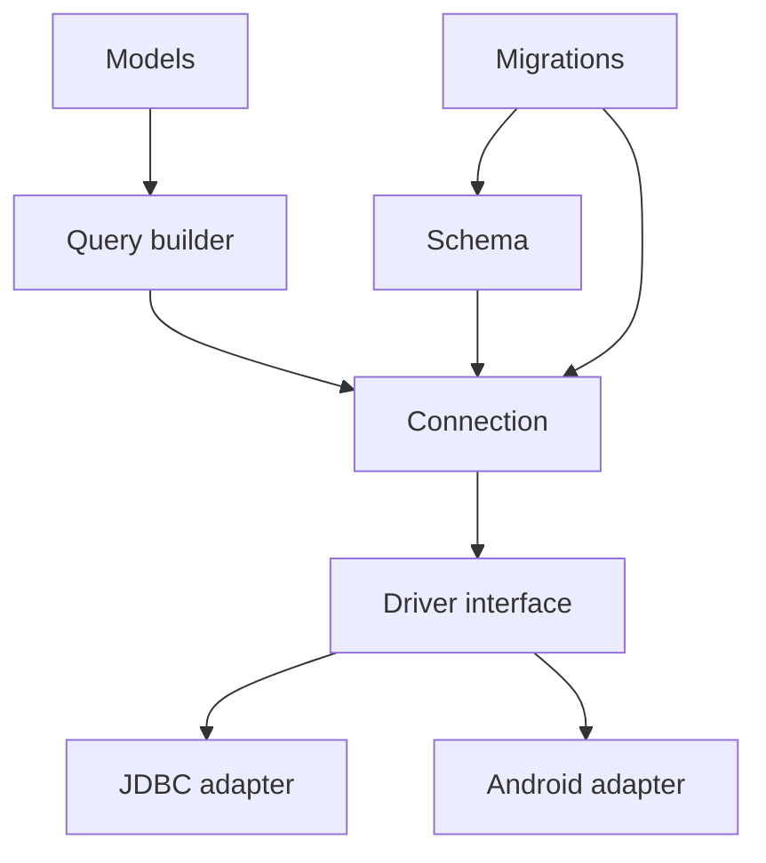
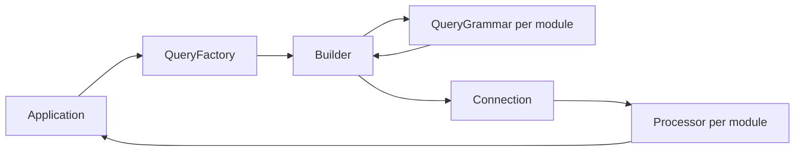

# System design

Diwan Database is a hand port of Laravel's database layer (`illuminate/database`) to Java. It
keeps Laravel's architecture layers and names where they read well in Java and uses Java's own
idioms where PHP shaped Laravel's choices.

## Layers

| Layer | Holds | Where it is described |
|---|---|---|
| Connection | Running SQL, transactions, pretend mode, errors | [connection-design.md](connection-design.md) |
| Driver interface and adapters | One physical connection per session; JDBC adapter; Android adapter later | [connection-design.md](connection-design.md) |
| Schema | Blueprint, column definitions, indexes and foreign keys, schema builder (built); a grammar per database module | [ADR 0008](../adr/0008-schema-grammar-per-database-module.md), [ADR 0010](../adr/0010-sqlite-table-rebuild.md), [requirements](../requirements/schema.md) |
| Migrations | Migration contract, migrations table and migrator (built); commands later | [ADR 0007](../adr/0007-migrations-table-without-a-schema-builder.md), [ADR 0009](../adr/0009-migrator-transactions-and-records.md), [requirements](../requirements/migrator.md) |
| Query builder | Fluent queries (built); a query grammar and processor per database module, passed in through `QueryFactory` | [ADR 0013](../adr/0013-query-grammar.md), [requirements](../requirements/query.md) |
| Models | Active-record models, relations, casts | not built yet |

## Platforms

Java 17 bytecode with no runtime dependency, so the same JAR runs on Java 17 and later desktop and
server runtimes, inside Spring applications, and on Android 9 (API 28) and later through a driver
that does not need JDBC.

## Modules

| Module | Artifact | Holds |
|---|---|---|
| `core` | `org.aristonis:diwan-database` | The connection, the driver interface, the JDBC adapter, migrations, the schema builder and the query builder; later layers join it when built |
| `sqlite` | `org.aristonis:diwan-database-sqlite` | The SQLite schema and query grammars and query processor, also used on Android |
| `pgsql` | `org.aristonis:diwan-database-pgsql` | The PostgreSQL schema and query grammars, query processor and migration lock |
| `android` | `org.aristonis:diwan-database-android` | The driver over Android's `SQLiteDatabase` |
| one per further database (planned) | `org.aristonis:diwan-<driver>` | That database's grammars and driver details |

## Diagram: Diwan Database layers

## Query layer

A `QueryFactory` holds a connection, a query grammar and a processor. Each `Builder` it makes
collects clauses as immutable typed objects and bindings in fixed buckets. The grammar compiles them to SQL
with placeholders and prepares the bindings (moments to each database's storage form); the
connection runs the SQL; the processor shapes the result and returns new keys. The core never
names a database module: the module shortcut (`SQLiteQuery.of`, `PostgresQuery.of`) passes its
grammar and processor in.

## Diagram: query flow

