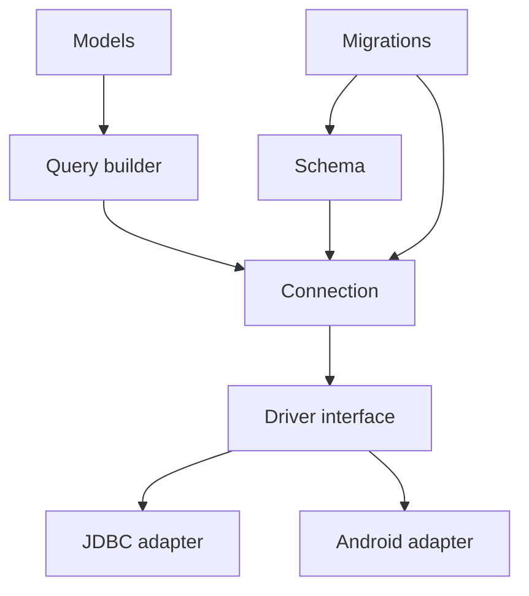

# System design

Photisma Database is a hand port of Laravel's database layer (`illuminate/database`) to Java. It
keeps Laravel's architecture layers and names where they read well in Java and uses Java's own
idioms where PHP shaped Laravel's choices.

## Layers

| Layer | Holds | Where it is described |
|---|---|---|
| Connection | Running SQL, transactions, pretend mode, errors | [connection-design.md](connection-design.md) |
| Driver interface and adapters | One physical connection per session; JDBC adapter; Android adapter later | [connection-design.md](connection-design.md) |
| Schema | Blueprint, column and index definitions, schema builder, schema grammars per database | not built yet |
| Migrations | Migration contract, repository, migrator, commands | not built yet |
| Query builder | Fluent queries, query grammars and processors | not built yet |
| Models | Active-record models, relations, casts | not built yet |

## Platforms

Java 17 bytecode with no runtime dependency, so the same JAR runs on Java 17 and later desktop and
server runtimes, inside Spring applications, and on Android 9 (API 28) and later through a driver
that does not need JDBC.

## Modules

| Module | Artifact | Holds |
|---|---|---|
| `core` | `org.aristonis:photisma-database` | The connection, the driver interface and the JDBC adapter; later layers join it when built |
| one per driver (planned) | `org.aristonis:photisma-database-<driver>` | That database's grammars and driver details |

## Diagram: Photisma Database layers

