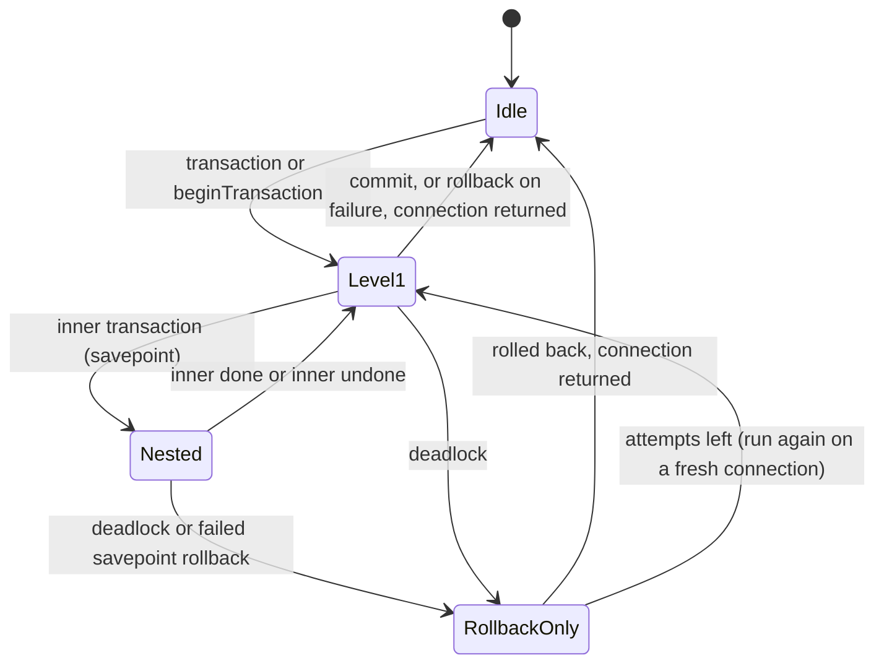

# Connection: user scenarios

Each edge case names the test that covers it, as `TestClass#method` under
`core/src/test/java/org/aristonis/photisma/database`. "Javadoc" means the documented contract is
the agreed coverage.

## Actors

| Actor | What they can do |
|---|---|
| Application developer | Run SQL, read rows, group work in transactions, dry-run work |
| Outer transaction owner | Start a transaction that Photisma then works inside |
| Several threads of one app | Use the same connection at the same time |
| Driver adapter author | Put a driver that is not JDBC under the connection |

## Settings

| Setting | Default | Effect |
|---|---|---|
| Connection name | required | Shown in errors |
| Table prefix | empty | Kept for later grammars; raw SQL is never changed; only letters, digits and underscores |
| Show values in error messages | off | Values can hold personal data; switch on for development |
| Strict transactions | on | The outer connection refuses calls from inside its own transaction |
| Cleanup-failure handler | warning through `java.util.logging` | Receives a failure to give a connection back after the work succeeded |
| Retry attempts for a transaction | 1 (no retry) | Set per call |

## Normal flow

### S1: Run SQL and read rows

1. The developer creates a table, adds rows, reads them, changes some and removes some.
2. Each call borrows a connection, runs, and gives it back.
3. Reads return rows in the database's order with columns in the order asked for.

### S2: Group work in a transaction

1. The developer runs several statements as one unit, with a callback or a scope.
2. When the unit finishes, all of it is saved; when it fails, none of it is.

### S3: Many threads, one connection

1. Several threads of the same app use one connection with a pool.
2. Each gets its own physical connection for each call or transaction.

### S4: Inside someone else's transaction

1. A Spring service starts a transaction and calls code that uses Photisma.
2. Photisma works inside that transaction and leaves ending it to its owner.

### S5: Dry run

1. A piece of work runs in pretend mode.
2. It returns the list of SQL with values; nothing reaches the database.

### S6: A driver that is not JDBC

1. An adapter author plugs in their own driver.
2. The connection runs the same calls through it and reports its failures the same way.

## Edge cases

### S1 edge cases

| # | Situation | What the actor sees or the system does | Test |
|---|---|---|---|
| E1 | A value of an unsupported type is passed | Refused at once with its position; nothing is sent | `RootConnectionTest#refusesAnUnsupportedBindingTypeBeforeOpeningASession` |
| E2 | A subclass of a supported type is passed | Refused the same way | `RootConnectionTest#refusesASubclassOfASupportedType` |
| E3 | A null value is passed | Stored as SQL `NULL` and read back as `null` | `JdbcSqliteTest#roundTripsEverySupportedBindingType` |
| E4 | A read finds no rows | Empty list; `selectOne` and `scalar` return an empty `Optional` | `RootConnectionTest#selectOneReturnsTheFirstRowOrNothing`, `RootConnectionTest#scalarReturnsTheFirstValueOrNothing` |
| E5 | The SQL is wrong or a table is missing | `QueryException` with the SQL and the SQL state; the connection goes back | `JdbcSqliteTest#reportsBadSqlAsAQueryException` |
| E6 | A duplicate key is inserted | `UniqueConstraintViolationException`, without the value in the message | `JdbcSqliteTest#reportsADuplicateKeyAsAUniqueViolationWithoutTheValueInTheMessage` |
| E7 | `scalar` selects two columns | `MultipleColumnsSelectedException` instead of a silent first value | `RootConnectionTest#scalarRefusesARowWithSeveralColumns` |
| E8 | The caller tries to change a returned row | Refused; rows are read-only | `RootConnectionTest#selectsRowsInOrderAsUnmodifiableMaps` |
| E9 | A read returns two columns with the same label (a join) | `QueryException` naming the label; an alias fixes it | `JdbcSqliteTest#refusesTwoColumnsWithTheSameLabel` |
| E10 | A read returns a large text, binary, XML or array value, or an old date type | Comes back as `String`, `byte[]`, `List` or `java.time`, usable after the call | `JdbcValuesTest#readsLargeObjectsAndOldDateTypesAsPlainJavaValues` |
| E11 | Values are passed as a list | Works like varargs | `RootConnectionTest#acceptsBindingsAsAList` |
| E12 | A null bindings array is passed | Refused clearly | `RootConnectionTest#refusesANullBindingsArray` |
| E13 | The caller changes its bindings list after the call | The call is unaffected; it kept its own copy | `RootConnectionTest#keepsItsOwnCopyOfTheCallersBindings` |
| E14 | The pool has no free connection and times out | The pool's failure reaches the caller as a `QueryException`; nothing is held | `RootConnectionTest#reportsAFailureToOpenASessionAsAQueryException` |
| E15 | The pool hands out connections with auto-commit off | Work outside a transaction is still committed; no connection is left open | `JdbcPoolSettingsTest#keepsWorkDoneOutsideATransactionWhenThePoolHandsOutAutoCommitOff` |
| E16 | The statement succeeded but giving the connection back fails | The result is returned; the failure goes to the cleanup-failure handler | `RootConnectionTest#returnsTheResultWhenGivingTheSessionBackFails` |
| E17 | The cleanup-failure handler itself throws | The result is still returned | `ErrorPrivacyTest#keepsTheResultWhenTheCleanupHandlerItselfFails` |
| E18 | A table prefix holds characters other than letters, digits and underscores | Refused when the connection is built | `ErrorPrivacyTest#refusesATablePrefixThatIsNotAPlainIdentifier` |

### S2 edge cases

| # | Situation | What the actor sees or the system does | Test |
|---|---|---|---|
| E1 | The work throws halfway | Everything in it is undone; the same exception reaches the developer | `TransactionTest#rollsBackAndRethrowsTheSameExceptionWhenTheCallbackThrows` |
| E2 | An inner unit fails and the outer work handles it | Only the inner part is undone; the outer one can still finish | `TransactionTest#undoesOnlyTheInnerWorkWhenTheOuterCallbackHandlesTheFailure`, `JdbcSqliteTest#undoesOnlyTheInnerPartThroughARealSavepoint` |
| E3 | The inner failure is not handled | Both are undone; the exception reaches the developer | `TransactionTest#undoesEverythingWhenAnInnerFailureIsNotHandled` |
| E4 | A scope is never committed (forgotten, or an early return) | Closing it undoes the work | `TransactionScopeTest#rollsBackWhenClosedWithoutCommit` |
| E5 | The database reports a deadlock and attempts remain | The whole callback runs again on a fresh connection | `TransactionTest#retriesTheWholeCallbackOnAConcurrencyFailure` |
| E6 | Every attempt deadlocks | The last failure reaches the developer | `TransactionTest#givesUpAfterTheLastAttempt` |
| E7 | Any other failure | Not retried | `TransactionTest#doesNotRetryOtherFailures` |
| E8 | The callback catches a deadlock on its own connection and carries on | The attempt is rolled back and retried, because the database may have dropped it | `TransactionHardeningTest#retriesWhenACallbackSwallowedADeadlockOnItsOwnConnection` |
| E9 | The callback throws a deadlock that came from another connection | Not retried | `TransactionHardeningTest#doesNotRetryADeadlockThatCameFromSomewhereElse` |
| E10 | The commit itself fails | The failure reaches the developer, the connection goes back, and the work is never retried, because the commit may have landed | `TransactionTest#reportsAFailedCommitAndStillGivesTheSessionBack`, `TransactionHardeningTest#neverRetriesAFailedCommitBecauseItMayHaveLanded` |
| E11 | The rollback itself fails after a failure | The original failure reaches the developer with the rollback failure attached; the connection goes back | `TransactionTest#attachesARollbackFailureToTheOriginalFailure` |
| E12 | The rollback throws an `Error` | The connection still goes back and the thread is freed | `TransactionHardeningTest#givesTheSessionBackAndFreesTheThreadWhenRollbackThrowsAnError` |
| E13 | Work inside a transaction goes through the outer connection | Refused at once (strict mode, on by default) | `TransactionTest#refusesARootCallFromInsideItsOwnTransaction` |
| E14 | The same with strict mode off | Runs, outside the transaction | `TransactionTest#allowsARootCallInsideATransactionWhenStrictModeIsOff` |
| E15 | A deadlock inside an inner unit makes the database drop the whole transaction | Later statements and the commit fail; nothing is saved; the outermost level rolls back | `TransactionTest#refusesToCommitAfterTheDatabaseLostTheWholeTransaction`, `TransactionTest#refusesFurtherStatementsOnceTheTransactionIsRollbackOnly` |
| E16 | The commit succeeded but giving the connection back fails | The result is returned; the failure goes to the cleanup-failure handler | `TransactionTest#keepsTheResultWhenGivingTheSessionBackFailsAfterCommit` |
| E17 | The attempt count is zero or negative | Refused before anything runs | `TransactionTest#refusesFewerThanOneAttempt` |
| E18 | The database cannot release savepoints | The savepoint is left in place; the transaction still works | `TransactionTest#keepsTheSavepointWhenTheDatabaseCannotReleaseIt` |
| E19 | Several inner units run at the same depth, some rolled back | Each savepoint gets its own name (`photisma_2`, then `photisma_2_1`) | `TransactionTest#givesEverySavepointInOneSessionItsOwnName` |
| E20 | The callback's connection is kept and used after the transaction ended | Refused with `IllegalStateException` | `TransactionHardeningTest#refusesACallbackConnectionUsedAfterItsTransactionEnded` |
| E21 | An inner scope is left open when a nested transaction returns | The scope is rolled back first; the level stays right | `TransactionHardeningTest#endsAScopeLeftOpenInsideANestedTransaction` |
| E22 | A scope's commit fails, then the scope is closed | Close rolls back and gives the connection back | `TransactionScopeTest#rollsBackAndGivesTheSessionBackWhenCommitFailed` |
| E23 | A scope is closed twice | The second close does nothing | `TransactionScopeTest#closingTwiceDoesNothing` |
| E24 | A scope is used after it ended | Refused with `IllegalStateException` | `TransactionScopeTest#refusesUseAfterItEnded` |
| E25 | An outer scope is closed while an inner one is open | The inner one is ended first | `TransactionScopeTest#endsAnOpenInnerScopeWhenTheOuterOneCloses` |

### S3 edge cases

| # | Situation | What the actor sees or the system does | Test |
|---|---|---|---|
| E1 | 8 threads run 200 inserts each at once | All 1600 rows are there | `JdbcSqliteTest#servesManyThreadsAtOnce` |
| E2 | Another thread uses the outer connection while a transaction is open | It runs on its own connection; strict mode refuses only the transaction's thread | `TransactionTest#allowsOtherThreadsToUseTheRootDuringATransaction` |
| E3 | A scope is closed on a different thread from the one that opened it | The opening thread is freed for strict mode | `TransactionHardeningTest#freesTheOpeningThreadWhenAScopeIsClosedOnAnotherThread` |
| E4 | A transaction scope is used from another thread while open | Not supported; a scope belongs to one thread | Javadoc |

### S4 edge cases

| # | Situation | What the actor sees or the system does | Test |
|---|---|---|---|
| E1 | Photisma's unit finishes inside the outer transaction | Nothing is committed; only a savepoint is used | `TransactionTest#worksInsideAnExternalTransactionThroughASavepointOnly` |
| E2 | Photisma's unit fails inside the outer transaction | Only Photisma's part is undone; the failure goes to the outer owner | `TransactionTest#undoesOnlyItsOwnPartInsideAnExternalTransaction` |
| E3 | The outer owner rolls back after Photisma finished | Photisma's work is gone too; auto-commit was never touched | `JdbcSqliteTest#joinsATransactionOwnedByTheProviderInsteadOfEndingIt` |
| E4 | A deadlock inside the outer transaction | Not retried; the failure goes to the outer owner | `TransactionTest#neverRetriesInsideAnExternalTransaction` |
| E5 | Something asks the JDBC session to begin, commit or roll back the outer transaction | Refused | `JdbcPoolSettingsTest#refusesToStartOrEndATransactionItDoesNotOwn` |

### S5 edge cases

| # | Situation | What the actor sees or the system does | Test |
|---|---|---|---|
| E1 | Statements run in pretend mode | Each is listed with its values; nothing is sent | `PretendTest#recordsEveryStatementWithItsBindingsWithoutTouchingTheDatabase` |
| E2 | A read or a write runs in pretend mode | No rows, 0 changed rows, empty `Optional` | `PretendTest#answersWithNeutralResults` |
| E3 | A transaction runs inside pretend | Its statements go to the same list | `PretendTest#runsATransactionInsidePretendOnTheSameRecorder` |
| E4 | The recorder is kept and used after the callback returned | Refused; the returned list does not change | `TransactionHardeningTest#refusesThePretendRecorderAfterItsCallbackAndKeepsTheListFixed` |
| E5 | An unsupported value is passed in pretend mode | Refused as outside pretend | `PretendTest#stillRefusesUnsupportedBindings` |

### S6 edge cases

| # | Situation | What the actor sees or the system does | Test |
|---|---|---|---|
| E1 | A driver that is not JDBC reports a failure | The same `QueryException` shape as with JDBC | `RootConnectionTest#wrapsADriverFailureWithTheSqlAndBindings` |
| E2 | The connection is lost with a deadlock-like code | Never treated as a concurrency failure, so never retried | `JdbcFailuresTest#neverTreatsALostConnectionAsAConcurrencyFailure` |
| E3 | A vendor code means a unique violation on one database and something else on another | Read only for the database that owns it | `JdbcFailuresTest#readsVendorCodesOnlyForTheDatabaseThatOwnsThem` |

### Error message edge cases

| # | Situation | What the actor sees or the system does | Test |
|---|---|---|---|
| E1 | A statement fails with default settings | The message has the SQL, the connection, the SQL state and the vendor code; no values, no database reason | `RootConnectionTest#hidesBindingsInErrorsUnlessShowingIsSwitchedOn` |
| E2 | The database's own error text echoes a value | It stays in the cause, never in the message | `JdbcFailuresTest#buildsItsMessageFromCodesOnlyAndKeepsTheOriginalAsCause` |
| E3 | SQL or a value holds line breaks or control characters | Escaped; the message stays one line | `TransactionHardeningTest#escapesEveryLineBreakingAndControlCharacterInMessages` |
| E4 | SQL or a value is very long | Shortened with `...` | `ErrorPrivacyTest#escapesLineBreaksAndShortensLongValuesInMessages` |
| E5 | An exception with hidden values is serialized | The values are left out | `ErrorPrivacyTest#leavesHiddenBindingsOutOfTheSerializedForm` |
| E6 | A recorded statement is printed | Shows the number of bindings, not the values | `ErrorPrivacyTest#loggedQueryTextCountsBindingsInsteadOfPrintingThem` |

## Effect on data

| Data | What happens to it | Reason |
|---|---|---|
| Rows written in a failed transaction | Undone | All or nothing |
| A pooled connection's auto-commit setting | Put back before the connection is returned | The next user expects the pool's setting |
| Work done inside someone else's transaction | Kept for its owner to commit or undo | Its owner decides |

Photisma never keeps a physical connection after a call or transaction returns, and never commits
or undoes work that belongs to a transaction it did not start.

## Lifecycle

### Diagram: transaction lifecycle

The final state is Idle with the connection returned; a joined outer transaction is never ended by
Photisma.

### Added later

| # | Situation | What happens | Test |
|---|---|---|---|
| L1 | A statement fails with values shown (development) | The message also has the database's reason, such as `no such table: tagz` | `JdbcSqliteTest#showsTheDatabaseReasonWhenValuesAreShown` |
| L2 | The reason is long or has line breaks | Escaped and shortened like the SQL | `QueryExceptionTest#escapesAndShortensTheDatabaseReason` |
| L3 | A failure is serialized | The database's reason is left out | `QueryExceptionTest#theDatabaseReasonIsNotSerialized` |
